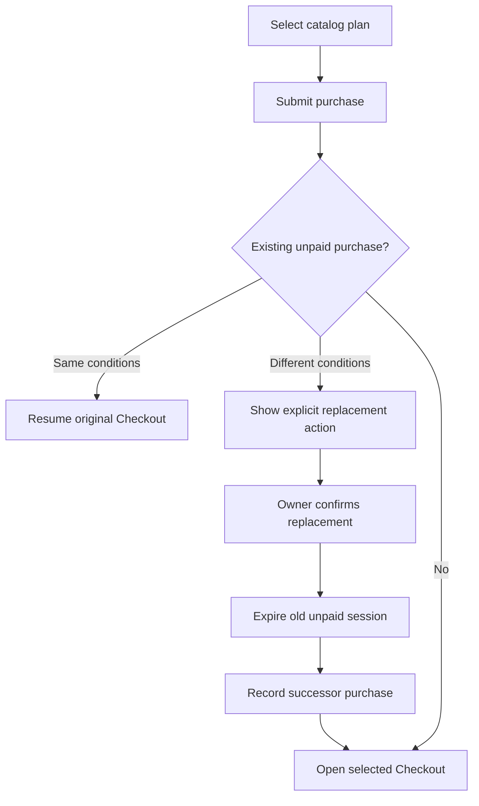
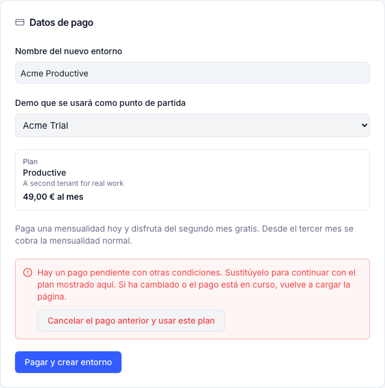

# ETP-6216 — Checkout selection and introductory offer

## Overview

The local implementation prevents a new plan selection from silently opening an older Checkout.
It requests explicit confirmation before replacing an unpaid purchase and presents the monthly
introductory offer only when the server declares it eligible. A focused local mocked browser test
passed the conflict and explicit replacement flow. No production payment, provider mutation or
deployment was performed.

Evidence updated on 2026-11-11; final backend validation used the unrestricted local environment. Delivery spans `etendo_schema_forge` and
`com.etendoerp.go`, both on `feature/ETP-6216` in the dedicated `etendo-ai/worktrees/ETP-6216` environment.

## Contents

- [User flow](#user-flow)
- [Acceptance matrix](#acceptance-matrix)
- [Visual evidence](#visual-evidence)
- [Automated validation](#automated-validation)
- [Scope and limitations](#scope-and-limitations)
- [Handoff signals](#handoff-signals)

## User flow

A company owner selects a catalog plan and reaches Payment. The purchase request carries the
selected `planKey`, never a browser-supplied Stripe Price or amount. If an unpaid purchase has
different commercial conditions, the page remains at Payment and offers an explicit replacement
action. Only that action submits the predecessor ID. Paid or provisioning purchases remain protected.

New eligible monthly purchases pay one monthly installment initially, receive the second calendar
month free, and resume normal recurrence in month three. Annual Prices already represent ten
monthly installments for twelve months and receive no additional annual discount.



## Acceptance matrix

| Scenario | Expected result | Status | Evidence |
|---|---|---|---|
| Different pending plan | Conflict stays on Payment; no automatic redirect | ✅ | Component tests and [local mocked browser check](#browser-check) |
| Explicit replacement | Second POST carries selected plan and predecessor ID | ✅ | API/component tests and focused browser request assertions |
| Monthly eligibility | Offer text appears only for server-enabled plans | ✅ | UpgradePage component suite: 103 passed; eligible offer visible in browser capture |
| Price and recurrence mismatch | Backend refuses mismatched catalog/Stripe terms | ✅ | Normal Gradle selection: 239 passed; provider boundaries use mocks and localhost HTTP fixtures |
| Monthly promotion | First installment paid; month two free; month three normal | ⚠️ | Local provider-adapter and zero-invoice lifecycle tests passed; Stripe Test Clock verification pending |
| Annual promotion | Ten monthly installments cover twelve months without another discount | ⚠️ | Terms tests passed; live configuration not inspected |
| Paid/provisioning protection and concurrency | Replacement never discards a paid purchase or duplicates payment | ⚠️ | Selected mocked Java tests passed; database locking and concurrency integration remain unverified |

## Visual evidence

### Browser check

Environment: **local UX / mocked backend**, `BASE_URL=http://127.0.0.1:3136`. The focused
Playwright scenario passed with one worker and zero retries. It asserts the first purchase returns
409 and stays at Payment, the explicit replacement action submits the selected plan with the
predecessor ID, and the second request receives 201 before navigating to a locally intercepted
mock Checkout page. No page errors were observed.

<details>
<summary>Payment conditions and explicit pending-purchase replacement</summary>

ETP-6216: the Payment container shows the selected fictional Acme monthly plan, the second-month-free
calendar, and an explicit button to replace a pending purchase with different conditions. Produced
by the passing local mocked Playwright scenario; this proves presentation and client transitions,
not Stripe or control-plane integration. The screenshot was inspected and contains no real user,
payment, session or authentication data.

<p align="center">
  
</p>

</details>

## Automated validation

### Functional application

Fresh validation after restoring dependencies from the unchanged lockfile: UpgradePage component
suite **103 passed** (12.82 seconds); upgrade API suite **87 passed** (0.24 seconds). These results
are unit/component validation, separate from the focused browser check below.

```sh
# Functional repository root
node --test tools/app-shell/src/lib/__tests__/upgrade-api.test.js
# tools/app-shell/
npm run test:vitest -- src/pages/__tests__/UpgradePage.vitest.jsx
```

Independent QA checks completed:

```text
node --check e2e/tests/flows/system/tenant-upgrade-cookie.mocked.spec.js
git diff --check
Result: PASS
```

Narrow browser command, run from `e2e/`:

```sh
CI=1 E2E_USE_MOCK=1 E2E_RETRIES=0 E2E_WORKERS=1 E2E_CAPTURE_SCREENSHOTS=1 BASE_URL=http://127.0.0.1:3136 npx playwright test tests/flows/system/tenant-upgrade-cookie.mocked.spec.js --project=mocked --grep 'different pending plan' --workers=1
```

Result: **1 passed in 18.8 seconds**, zero retries, one worker. The successful scenario generated
the sanitized screenshot above. Observed requests: first purchase **409**, confirmed replacement
purchase **201**, followed by the locally mocked Checkout destination. The scenario asserts no
page errors.

The Vite server was started from `tools/app-shell/`:

```sh
npx vite --host 127.0.0.1 --port 3136 --strictPort
```

The earlier sandbox/browser-launch failure and copied CLI mismatch were resolved in a fresh
unrestricted validation session. `npm ci --prefer-offline --no-audit --no-fund` restored the exact
lockfile dependencies, including CLI `0.3.98`; neither `package.json` nor `package-lock.json`
changed. The local server returned HTTP 200 and was stopped after validation; port 3136 was free.

Audit logs: `/private/tmp/etp6216-npm-ci-unrestricted.log`,
`/private/tmp/etp6216-vite-unrestricted.log`, `/private/tmp/etp6216-playwright-unrestricted.log`,
`/private/tmp/etp6216-api-unrestricted.log` and `/private/tmp/etp6216-vitest-unrestricted.log`.

### Backend

The canonical Gradle command completed **BUILD SUCCESSFUL in 1 minute 55 seconds**, including
`compileJava`, `compileTestJava` and `goTestUnit`. The selected ten JUnit classes report **239 tests,
zero failures, zero errors and zero skipped tests** in their XML reports. This includes all
15 `StripePriceServiceTest` cases using real localhost HTTP fixtures. The earlier 224-test fallback
result is historical; the normal Gradle result below supersedes the old cache/socket restrictions.

From the dedicated Etendo environment root (`etendo-ai/worktrees/ETP-6216`), using JDK 17:

```sh
JAVA_HOME=/Users/sebastianbarrozo/Library/Java/JavaVirtualMachines/corretto-17.0.18/Contents/Home ./gradlew goTestUnit \
  --tests 'com.etendoerp.go.payment.CheckoutPromotionTermsTest' \
  --tests 'com.etendoerp.go.payment.MonthlySecondMonthPromotionServiceTest' \
  --tests 'com.etendoerp.go.payment.PromotionRecoveryTest' \
  --tests 'com.etendoerp.go.payment.SubscriptionLifecycleApplierTest' \
  --tests 'com.etendoerp.go.payment.HostedCheckoutServiceTest' \
  --tests 'com.etendoerp.go.payment.HostedCheckoutSessionPlanTest' \
  --tests 'com.etendoerp.go.payment.HostedCheckoutLegacyFallbackTest' \
  --tests 'com.etendoerp.go.payment.StripePriceServiceTest' \
  --tests 'com.etendoerp.go.rest.EtendoGoJwtServletBillingCookieAuthTest' \
  --tests 'com.etendoerp.go.rest.EtendoGoJwtServletTest' \
  --console plain
```

Audit log: `/private/tmp/etp6216-gradle-unrestricted-final.log`. Machine-readable results are in
`build/test-results/goTestUnit/TEST-<class>.xml` under the environment root. The selected XML
counts and successful build log were independently inspected. Expected mocked error-path logs,
compiler warnings and Gradle deprecation warnings did not fail the selected suite.

Environment preparation preserved the core feature history while merging the canonical
ETP-3504 core baseline into this isolated environment (`47b2c1f6`). Its local SQLC fixture was
regenerated with the real SQLC generator against this environment's own PostgreSQL database
(`etendo_local`, port 55437). These are local build prerequisites, not application source changes
in either delivery PR; the original checkout and production were not changed.

Coverage includes explicit replacement, completed/uncertain provider refusal, changed plan or
recurrence, snapshot terms, duplicate schedule application, ambiguous schedule creation recovery,
foreign schedules, expired eligibility windows, provider reference normalization, isolated recovery
failures and the zero-amount second-month invoice. This does not validate actual database locks,
atomic transactions, provider requests or the real Stripe subscription schedule lifecycle.

## Scope and limitations

- The focused mocked browser scenario passed; the full browser suite and real control-plane
  integration were not executed by this focused QA run.
- No new organization, Stripe Checkout Session, payment, coupon or subscription schedule was
  created by this QA run.
- Production configuration and the exact Price mapping behind the observed 110 EUR/year session
  remain unverified. This local change is not evidence of deployment.
- Live Stripe Test Mode clock verification must cover month boundaries, the zero-amount
  month-two invoice, normal month-three billing and webhook retries.
- Annual catalog configuration must be checked separately: the annual Stripe Price must already
  charge ten monthly installments. The code prevents another annual promotion; this run did not
  confirm production Price amounts or change their configuration.
- Crash recovery requires the existing Billing Reconciliation process to run. Its scheduled
  feature flag is off by default and was not enabled by this work.
- Pending validation by QA: Matías Bernal / Emilio Polliotti.

## Handoff signals

- Jira: [ETP-6216](https://etendoproject.atlassian.net/browse/ETP-6216).
- Functional spec: [Checkout plan consistency](../../../docs/plans/2026-11-11-checkout-plan-consistency.md).
- Browser scenario: `tenant-upgrade-cookie.mocked.spec.js`, test `a different pending plan requires explicit replacement before the selected monthly checkout opens`.
- Test author report: Extended: 1 · Rewritten: 0 · New: 0. Existing cookie-session Checkout spec
  reused; test reviewed independently by the implementation agent. Reviewer did not approve its own test.
- No commit, push, PR publication, merge or deployment is implied by this package.
